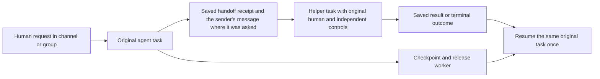

# Channel-visible agent handoffs

Implemented locally on `feat/channel-agent-handoffs`, serially following PR 74.
This contract was saved as a plan before application edits. The acceptance section
records executed local behavior and the remaining provider/cloud boundary.

## Product and authority contract

A running workspace agent can explicitly ask another managed workspace agent for
help in the same existing channel or group, where it was asked (the main timeline or
that thread; [visible exchanges](#visible-in-the-conversation-schema-100-d246)). Ordinary chatter does not
start work. There is no private direct-agent route or cross-channel publication.
A human's original request remains the principal: both agents must participate and
that person must have current independent request permission for each. Agent
configuration, membership and visibility never become implied business authority.

The controller discovers eligible helpers and accepts a stable-key handoff through
the exact current task capability. It atomically saves an agent-authored channel
message, linked child task and immutable parent/root/principal/thread receipt.
Retries reuse the exact saved handoff, including after worker/controller loss;
changed contents with an accepted key fail. Identical target/instructions with a
new model-generated key return the original canonical receipt, preventing worker
recovery from manufacturing another helper task. Root-to-descendant loops, self-handoffs,
more than three levels, more than two direct children, more than eight total child
tasks and unbounded waits are rejected. `AYATI_HANDOFF_WAIT_SECONDS` defaults to
seven days (60 seconds to 30 days supported); a descendant cannot extend its
root handoff deadline. These are operational controls rather than
new subscription entitlements. One unfinished child per sender at a time keeps
coordination understandable; completed siblings remain inspectable.

Receiving agents use only their own current configured tools and knowledge. A
business operation must also fit each sender's snapshotted and still-current
operation rule along its lineage. Missing/Block denies; an ancestor's Ask ceiling
requires an independent receiver Ask rule with the same designated approver. The
controller does not silently broaden or rewrite a receiver's standing rules.
Final dispatch and approval decisions recheck these ceilings. Uncertain writes
retain their ordinary receipts and cannot be retried by changing agents.

## Source publication and retention

Handoff instructions are a bounded explicit message, not a copy of the sender's
private prompt, notes, credentials or transcript. Only the existing channel/group and
thread audience can see them. Private-agent/private-DM/Library-source handoffs and
email/WhatsApp threads are outside this slice; reject rather than publish across that boundary.

Connected-event source data may be passed only when each receiving agent has its
own effective Allow read for the same reviewed source/account/destination and the
original person retains standing read authority. Save receiver read versions with
the handoff. The bounded task tree retains those source requirements: derived
parent/child output, questions, approvals, readers, attention and progress remain
source-checked after a result is returned. Source revocation cannot leak through
a parent's eventual answer. Scope-aware live invalidation clears affected content.
Independent later conversation prompts exclude event-derived messages and every
message of a handoff tree with any source-bearing part (since D246 a plain exchange
is remembered whole; see [later memory](#later-memory-d246)); continuation uses the
exact original-task receipts and authorized child result.

The source requirements cover the whole bounded tree after a result has returned,
so a parent's later answer cannot bypass a helper's event-read revocation. Pin
source/read versions for every receiving agent and emit the existing source/chat
invalidation when one changes. The original event remains retained while the parent
waits; normal event cleanup can erase input after the tree is terminal. Explicit
handoff messages and root/child replies of a source-bearing tree are excluded from
unrelated future prompt assembly. Ordinary channel history remains readable under its own source checks.

Operation ceilings are captured from the sender's effective rules at admission
and rechecked against current versions along the ancestor path. Receiver actions
may only be equal or more restrictive; incompatible Ask approvers deny that action
rather than silently assigning new authority. The child still has independent
exact action receipts, approvals and uncertain-write holds.

## Asynchronous lifecycle

After requesting help, the sender reports what is waiting and finishes its bounded
attempt. Save its checkpoint and release the worker. A child may complete before
or after that checkpoint; either ordering queues the same parent continuation once.
The parent resumes from current authorized receipts, never by polling a model or
starting another independent business task. Human questions and exact approvals
compose with this wait; status/history reads make no model calls.

Show sender, receiving agent, original requester, current state and links to the
parent/child where the request was asked (main timeline or thread) and in the Agents Work view. Stop a child
returns a cancelled outcome to the parent. Stop a parent/root cancels unfinished
descendants; restart or redelivery cannot revive them. Source/request/participation
revocation permanently fences affected work. Archiving blocks new handoffs while
preserving accepted continuations. Expiration is recorded as a terminal outcome,
not a silent automatic retry. No cancelled/uncertain external effect is presented
as undone.

## Visible in the conversation (schema 100, D246)

The owner's request (2026-11-07): when someone asks one agent in a channel to get
something from another, the two agents talk in the conversation where both are and
the people there see it. In AWS window 1 they couldn't: the exchange was saved in a
thread under the sender's reply, and the main timeline showed only a card on it.

- **Placement.** The sender's handoff message and the helper's answer go where the
  sender was asked: on the main timeline when the request was there, in its thread
  when it was in one. The sender's resumed answer is still its original reply (the
  job's message, created when it was asked), and it reads after the exchange: the
  client places a reply after its handoff messages and their answers in the same
  place, as it already places a reply after its working-voice updates
  (`mergeMessages`; a helper that asked a third agent reads after that agent). People
  read "@Atlas ask Nova about walnut", Atlas: "Nova, can you check the walnut stock
  for Kapoor?", Nova's answer, then Atlas's result.
- **Storage.** Schema 100 (`m20261107_000100_visible_handoffs`) lets
  `relay_agent_handoffs.thread` be NULL for the main timeline. Receipts saved
  before it keep their thread under the sender's reply and display as before;
  receipts stay immutable.
- **Card.** The approved card (sender → helper, "Agent handoff · state", who asked,
  "keeps its own permissions and the sender's limits", Open helper task, Open original
  task, Stop helper task) sits on the handoff message, without repeating the task the
  message already shows. The helper's answer keeps "Helping Atlas · Requested by …".
  The sender's reply shows the card only for an earlier exchange kept in a thread
  under it, so each exchange has one card. Open helper task links to the answer
  without a thread when it is on the main timeline.
- **Authorization is unchanged.** A thread has the same readers as its conversation,
  so the same people see the messages. Per-viewer source redaction (`reply_views`,
  `handoff_views`) is unchanged: a viewer without source access sees "Handoff
  unavailable because source access changed." and "Response unavailable…" in the
  same places (the sender's reply, shown without handoff details, keeps its first
  position). The helper keeps its own permissions and every sender ceiling. On the
  main timeline the exchange counts like any agent message for unread counts and
  activity ordering.
- **Groups.** A group hands off with the channel rules: both agents are managed shared
  agents in it, the person may ask both there now (group members may ask its agents
  unless one is paused or private), it is not archived, and the depth, fan-out,
  total, cycle and self limits apply. `handoff_targets`, the guidance and
  `request_handoff` share that check (`participant`). Direct messages (one agent) and
  email/WhatsApp threads (stored as groups bound to a transport) still cannot.
- **Guidance.** The agent is told its task is posted as its message where it was
  asked, with the helper's answer below it, so it writes to that agent by name
  without anything the people there may not see; and that when it continues they
  have read the answer, so it builds on it instead of repeating it in full.

### Later memory (D246)

The guide kept every handoff message out of later prompts for two reasons. Source:
a helper's answer may be built from connected-event data, a business operation,
Library documents or notes that each reader must still be allowed, and the sender's
later reply restates it; conversation membership is no renewed permission. Authority:
helper output is untrusted evidence, and a failed, stopped or truncated result is no
effect. Both reasons are about the source-bearing parts. An exchange that used none
is ordinary conversation every member already reads, like a person asking each agent
in turn, and agents should remember what was agreed in it.

Rule: **an exchange is remembered whole or not at all** (`source_exclusions`). Its
request messages, helper answers and the sender's reply enter later conversation
context and the history tools only when every message of its tree (the original
reply, each request, each helper answer) passes the ordinary per-message exclusions
(business operations, event deliveries, Library sources and changed reads, changed
context versions, Home update runs, knowledge source messages, communication scope)
and no receipt carries an event source or a revoked source. Otherwise the whole
exchange stays out, because a helper's output flows into its sender's reply. This
mirrors `handoff_access::source_allowed`, which hides the whole tree from a viewer,
and like the other exclusions it does not depend on who asks next: a remembered
exchange is one every reader of the conversation can see, so a later reply can't
carry source-bearing content to someone without access.

Remembered messages carry `handoff: {role: request|answer, from, to, state}` in the
evidence, and the prompt says a helper's answer is that agent's evidence, not a
person's decision, and that a failed, cancelled or expired handoff produced no
result. A structured note in place of a source-bearing exchange ("Earlier, Atlas
asked Nova …; Nova answered …") was not added: with the answer it would bypass the
exclusion, and without it it says little while revealing who asked whom to a
reader whose source access changed. Asking again rechecks current access.

In practice a helper answering from the conversation or its own reasoning is
remembered; one that read an order through a connected tool is not, exactly like a
direct reply that used a tool.

### Checks (D246)

- PostgreSQL `handoff_admission::visibility_tests`: a main-timeline handoff saves
  the request, the answer and the receipt without a thread and shows them to another
  channel member, with the card data on the request and the answer's origin; a
  handoff asked in a thread stays in it; a group hands off with the same eligibility
  (paused helper, agent outside the group, self, cycle) and the guidance lists the
  helper; a direct message can't; an event-sourced exchange is on the main timeline
  and redacted there once the helper's read is blocked; the 99 → 100 upgrade keeps an
  earlier threaded receipt and saves a new main-timeline one without a thread.
- PostgreSQL `conversation_context::handoff_memory_tests`: a later request's prompt
  and the history tools include a plain exchange (marked `handoff`) and leave out a
  tool-backed one whole. Updated: `handoff_tests` (placement; a plain exchange is
  remembered), `conversation_history_source_tests` (a tool-backed exchange is
  excluded), guidance tests (groups, wording). The event-source exclusion tests are
  unchanged and pass.
- Web `tests/chat-visible-handoffs.test.mjs`; journeys `tests/agent_handoffs.mjs`
  (new captures in `designs/channel-agent-handoffs/`) and
  `tests/agent_handoff_sources.mjs` with real pinned Goose and a scripted provider.

## Implementation sequence

1. Inspect the current channel/control/continuation boundaries and live OpenPencil
   documents; save desktop/phone channel-handoff concepts before UI edits.
2. Add schema 29 receipts, bounded atomic child admission and saved wait/resume;
   reuse the ordinary pooled background intake and current worker capabilities.
3. Add shared source/ceiling guards and lifecycle propagation across Stop,
   revocation, completion, checkpoints and original-source disclosure paths.
4. Expose understandable channel/Work references and original-task navigation;
   preserve loading/error/revocation, keyboard, draft and small-window behavior.
5. Prove two-controller exact handoff, self/cycle/fan-out limits, no privilege
   amplification, parent/child Stop, source revocation including returned output,
   result-before-checkpoint and checkpoint-before-result, queue rollback,
   restart/reconstruction and one separately approved MCP-fixture write using real
   pinned Goose and scripted local inference. Retain records and actual captures.
6. Run focused plus risk-appropriate regression checks and publish one dependent
   PR after #74 before starting another feature. Never migrate the normal DB or
   activate cloud/paid inference.

A2A networking, cross-channel/private-agent delegation, arbitrary source migration,
parallel filesystem/browser execution and real cloud/provider acceptance remain
separate work. This plan does not promise launch completion or production capacity.

## Runtime and local verification

Schema **29**, `m20261026_000029_channel_agent_handoffs`, adds immutable handoff
receipts, source/permission snapshots, bounded wait metadata and terminal outcomes.
The populated-v28 migration preserves an existing pending question and resumes
its same original task after an answer. Apply explicit migrations/grants only to
the intended deployment; current startup follows [PostgreSQL workspaces](postgres-workspaces.md).
The normal workspace database was not migrated by these checks.

`handoff_targets {}` and `request_handoff {key,agent,task}` use the existing exact
per-task worker capability and controller-owned MCP bridge. Users/models cannot
supply another principal, parent, workspace, channel, thread or permission set.
Shared pooled execution is required. Other adapters fail without admitting work.
The UI requires no invented connector grants or separate handoff permission form.

A channel or group task's instructions say when to hand off: when someone asks the agent to
ask, get something from, check with or coordinate with another agent, it calls
`request_handoff`; writing `@Name` in its reply does not reach that agent. They say
the task is posted as the agent's message where it was asked and the helper answers
below it, so it is written to that agent by name ("Nova, can you check the walnut
stock for Kapoor?") with nothing the people there may not see. They
list the helpers eligible when the task is prepared (name, ID and role), using the
same checks as `handoff_targets`, which the agent calls if the list may be stale.
With no eligible helper they say so in one sentence: no other managed shared agent
is in the conversation, or the others are already in this handoff or may not work for
this person. Direct messages and email/WhatsApp threads get no
handoff instructions. A handoff task may name agents with mention links: they stay
plain text and only the handoff's target is asked.

A helper result enters its parent's continuation as at most 2,000 characters with
an explicit `truncated` marker and original source link. The complete saved child
response remains available through its authorized reader; the original result is
not shortened in storage. Truncated/stopped/failed outcomes do not establish that
an external effect succeeded. Completed and uncertain operation receipts are
shared across the logical task tree so changing agents cannot replay the same
operation/fields as a new effect.

A helper task must checkpoint before the sender starts more work, even if the
helper finishes quickly. Both completion/checkpoint orderings queue exactly one
continuation. An owned bounded controller loop checks at most 20 pending roots
per pass with fair rotation; it records expiry without idle inference. Controller
replicas serialize only the necessary workspace mutations. These local controls
are not throughput, cost or cloud-deadline acceptance.

Verified locally:

- 101 root Rust unit and seven guest-bridge checks, 216 disposable PostgreSQL,
  157 web and 52 offline Python checks.
  Eighteen PostgreSQL handoff cases cover exact and semantic replay across
  replicas/new model keys, queue rollback, self/cycle/depth/fan-out limits,
  immutable deadlines, expiry, both checkpoint/result orderings, Stop, archive,
  membership/regrant, missing/Ask/Allow ceilings, no delegation around unresolved
  input/approval/uncertainty, whole-tree exact operation reuse and returned-source
  privacy including handoff request readers.
- Real pinned Goose with scripted local inference hands work to Atlas, releases
  Nova, asks the original person a question, survives controller/executor restart,
  requests separate exact approval, performs one confirmed authenticated MCP
  fixture write, then resumes Nova from the saved result. Child and parent Stop
  terminate the correct linked work; another restart starts no replacement work.
- A second real Goose journey passes a signed event to a helper with independent
  Allow read authority, returns its saved result to the parent, then revokes the
  helper read. The open parent reader and all source-bearing parent/child/request
  reads become unavailable; regrant/restart cannot revive them. This journey
  performs zero MCP calls. Status/history reads make no model calls.
- Desktop, phone, dark and source-reader captures were inspected. Web behavior
  checks cover guarded Stop, failed saves, exact navigation and immediate scoped
  clearing while preserving an unrelated chat draft. Denied reader retries now
  leave a usable error state instead of a stuck loading indicator.

Complete regression/process totals and check artifacts are retained in
`.tmp/channel-agent-handoffs/verification.json` before publication. No paid model,
cloud resource, provider subscription or production/cloud acceptance was used.
Private-agent/DM/Library delegation, cross-channel publication, richer result
retrieval, A2A networking and concurrent per-agent computer/filesystem work remain
separate increments. Direct agent-to-agent routing is outside the accepted launch
scope. The whole product and launch acceptance contract remain incomplete.
