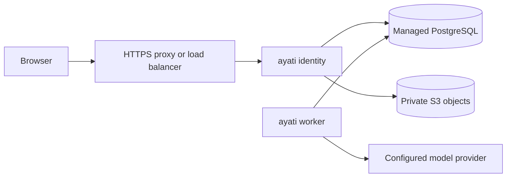

# Hosted deployment foundation

Current application startup requires the full [schema 24](chat-organization.md)
and runtime grants. The older deployment/image evidence below retains its
original scope; it does not establish acceptance for this new release.

The newer [assignment worker mode](assignment-workers.md) adds a local launch
rehearsal and requires migration 11. The Compose template below retains polling
workers; it is not yet an AWS on-demand task launcher.

This increment packages the website and independent conversation workers and
adds an explicit HTTPS gateway configuration. It prepares a private cloud
rehearsal; it does not provision an account, database, bucket, DNS or public site.
Local HTTP startup remains compatible when public configuration is absent.

The initial topology is deliberately small:



One image starts with `identity`, `worker`, or `workspace-db migrate`. Each API
replica and worker gets its own temporary writable directory. Accounts, sessions,
workspaces, conversations, jobs, agent profiles, avatars and Library pages live in
PostgreSQL. Library files and new hosted chat attachments use private S3 storage.
Workers read approved source text from PostgreSQL and do not need bucket or
WorkOS credentials. This is the existing tool-free conversation execution path.

## Build the artifact

From the repository root, with a working Docker/BuildKit daemon:

```sh
docker build --platform linux/amd64 -t ayati:hosted-local .
```

The Dockerfile pins Node 26.2.0, Rust 1.98.0 and Debian Trixie base image digests,
uses `npm ci` and `cargo build --locked`, builds the production website, and
installs the existing SHA-256-verified Goose 1.54.0 binary and the separately pinned
prepared variant for pooled execution. `BUILD_JOBS` defaults to 2 in both Rust
stages to bound local build pressure. It supports Linux amd64 only.
Debian package repositories still supply build-time package updates; this
is a versioned artifact, not a claim of bit-for-bit reproducible builds.

The context is an allowlist of source/build inputs. `.env`, local databases,
`proj-docs`, private data, screenshots and caches are excluded. No build argument
contains a credential. Runtime UID/GID is 10001, with certificates, Goose runtime
libraries, and the existing PDF extractor dependencies. Keep the same image digest
for migrations, API and workers in a release.

## Runtime configuration

| Setting | Purpose |
| --- | --- |
| `AYATI_PUBLIC_ORIGIN` | Canonical HTTPS origin, such as `https://workspace.example.com`; no path, credentials, query or fragment |
| `AYATI_BIND_ADDRESS` | Explicit internal listening IP; `0.0.0.0` for a private container network |
| `RELAY_DATABASE_URL` | Restricted runtime PostgreSQL URL; use provider-required TLS and private networking |
| `AYATI_CHAT_EXECUTION=external` | API queues jobs; separately supervised workers execute them |
| `WORKOS_CLIENT_ID`, `WORKOS_API_KEY` | API only; configure the exact public `/auth/callback` URL in WorkOS |
| `AYATI_WORKER_PROVIDERS` | API declaration of worker providers, `openai` and/or `fireworks-ai`, comma separated |
| `AYATI_MODEL`, `AYATI_GOOSE_PROVIDER` | Operator-tested default model/provider; workers need matching credentials |
| `AYATI_WORKER_CONCURRENCY` | Per-worker limit, 1–16, default 4 |
| `AYATI_WORKER_HEALTH_FILE` | Private absolute heartbeat path, one per worker; parent directory must exist |
| `CUCKOO_LIBRARY_S3_BUCKET`, `AWS_REGION` | Optional private bucket; ambient cloud credentials or scoped runtime secrets |
| `CUCKOO_LIBRARY_S3_ENDPOINT` | Optional HTTPS S3-compatible endpoint |

Public mode requires PostgreSQL and external workers. A non-default bind address
requires the public HTTPS origin. The gateway never derives its origin or cookie
security from `Forwarded`/`X-Forwarded-*` headers. It checks the configured Host and
exact mutation Origin; a proxy must preserve the public Host, including a
nonstandard port. Redirect HTTP to HTTPS at the proxy, keep backend ingress private,
and support long-lived SSE responses. TLS terminates at that proxy.

Both login and session cookies gain `Secure`; they remain HttpOnly, SameSite=Lax
and host-only, including cookie deletion. Ten-minute PKCE login state is kept in
PostgreSQL under the hashed flow-cookie value. Atomic deletion makes it single use
across API replicas. Expired state is pruned during intake, which has a shared
100-flow cap. This preserves the existing bound; it is not a public rate limiter.
Existing sessions already live in PostgreSQL and still undergo current provider
session/email verification on authenticated requests.

The API can declare worker providers without holding their model keys. That
declaration controls provider choices in agent setup; it does not prove a worker
is online or a particular model is available. Keep it consistent with the fleet.

## Secrets and service startup

`deploy/compose.yaml` is a single-host deployment/rehearsal template using external
PostgreSQL and optional external object storage. It exposes the API only on host
loopback and supplies separate API/worker secrets. Set a TLS proxy or managed load
balancer in front before allowing access. It is not a provider infrastructure stack.

Copy `deploy/hosted.env.example` to a private, ignored configuration file and
replace the placeholders. The sample is for OpenAI workers; use a separately
reviewed override for Fireworks credentials/provider settings. All profiles that
can be queued must have an available provider on the workers consuming that queue.

The image entrypoint accepts an environment value **or** a mounted `<NAME>_FILE`
for `RELAY_DATABASE_URL`, `WORKOS_API_KEY`, `OPENAI_API_KEY`,
`FIREWORKS_API_KEY`, `AWS_ACCESS_KEY_ID`, `AWS_SECRET_ACCESS_KEY` and
`AWS_SESSION_TOKEN`. It rejects conflicting, missing/unreadable and empty secret
files. It does not evaluate file contents or print values. Mounted files must be
readable by UID 10001; Compose bind-file secrets preserve host file permissions.
`RELAY_SIMULATION_DATABASE_URL_FILE` is also supported for explicit local
`simulate` rehearsals; it is not a normal hosted identity configuration.
Provision real secrets through the hosting secret manager, separately by service.
An API deployment never needs a model key; a worker never needs a WorkOS key.

The Compose API uses ambient object-storage identity. For a self-hosted S3 service,
add an API-only override mounting the AWS key files and setting the corresponding
`*_FILE` variables. Give it access only to the private application bucket. Do not
share that override or those credentials with workers. See [Library storage](library.md).

First migrate with a separate database-owner URL, then grant runtime DML rights:

```sh
docker compose --env-file /private/ayati/hosted.env -f deploy/compose.yaml config --quiet
docker compose --env-file /private/ayati/hosted.env -f deploy/compose.yaml \
  --profile maintenance run --rm migrate
```

For a dedicated `public` schema and existing `relay_app` runtime role, apply the
following with the migration owner after each migration. Adapt the schema/role
deliberately if your database uses different names:

```sql
GRANT USAGE ON SCHEMA public TO relay_app;
GRANT SELECT, INSERT, UPDATE, DELETE ON ALL TABLES IN SCHEMA public TO relay_app;
GRANT USAGE, SELECT ON ALL SEQUENCES IN SCHEMA public TO relay_app;
REVOKE UPDATE, DELETE ON public.relay_audit FROM relay_app;
REVOKE INSERT, UPDATE, DELETE ON public.seaql_migrations FROM relay_app;
```

Keep schema creation/ownership and database administration away from the runtime
role. Existing deployments must run all migrations through 24 (`m20261026_000024_chat_organization`)
and grants before starting this version. API/worker startup verifies the schema
and never migrates automatically. The database holds brief PKCE verifier and
invitation credentials too: restrict its operational access and backups accordingly.
The new [worker-control API](worker-control.md) is a separate local-only boundary;
this Compose template does not establish remote/cloud executor authentication.
M1.5b's [local prepared pool](executor-pool.md) is opt-in and is not configured by
this existing polling-worker Compose template.

```sh
docker compose --env-file /private/ayati/hosted.env -f deploy/compose.yaml up -d api worker
docker compose --env-file /private/ayati/hosted.env -f deploy/compose.yaml ps
docker compose --env-file /private/ayati/hosted.env -f deploy/compose.yaml stop
```

The template uses a read-only root filesystem, drops capabilities, prevents new
privileges, and supplies separate tmpfs scratch for each container. Do not mount
the local `.ayati-local` installation into hosted containers. Hosted mode refuses
local installation bindings and Library disk storage; it fences the old private
VM, local Apps, panels and resource-sharing APIs. Those features need their own
durable hosted adapters. The standard agent profile, conversation and Library
APIs continue to enforce their existing PostgreSQL permissions.

PDF extraction keeps its existing bubblewrap isolation. Some container hosts
disallow nested user namespaces; then extraction fails closed. Do not relax the
container security profile merely to make that optional extractor work.

## Supervision, replacement and recovery

- `GET /health/live` checks HTTP responsiveness without a database probe.
- `GET /health/ready` probes the database with a three-second deadline.
- `ayati api-health` probes internal loopback readiness without trusting proxy headers.
- `ayati worker-health` checks a live PID and a heartbeat no older than 20 seconds.
  The dispatch loop probes its database every five seconds and withdraws readiness
  on failure. Health-file writers are exclusive; graceful exit removes the signal.

Only the two read-only health GETs bypass the public Host check; they expose no
account, credential or diagnostic details. Readiness is not a model, storage,
WorkOS or end-to-end availability test. Monitor those dependencies separately.
Docker health status alone does not restart an unhealthy process; select the
hosting supervisor's recovery policy and alerts during the private cloud rehearsal.

SIGTERM drains API requests and stops Goose before releasing worker claims. Compose
allows 90 seconds. A forced kill still relies on lease expiry, and crash scratch
requires controlled reconciliation. Do not blindly replay business actions.

Before a schema change, take a verified backup and rehearse restoration. Migration
10 is additive but startup rejects unknown schema versions: the previous binary
will not run against version 10. Prefer a forward fix; restoring a backup requires
stopping writers and reconciling any acknowledged writes since that backup.

Without S3, Library pages remain available and file uploads are unavailable. New
hosted chat attachments use `chat/<workspace>/<id>` in the private object store,
with existing chat authorization and checksum checks. Old local chat files are
not migrated automatically. Bucket cleanup after uncertain uploads, object
retention/versioning and verified backup/restore still need operational rehearsal.
Object storage and database contents must survive replacement of every container.

## Local verification

Focused checks (database URLs must point at disposable local test databases):

```sh
cargo test --locked --lib
cargo clippy --locked --all-targets -- -D warnings
RELAY_TEST_DATABASE_URL='<local disposable administrator URL>' \
  cargo test --locked --lib identity::postgres -- --ignored --test-threads=4
RELAY_TEST_DATABASE_URL='<local relay_simulation_* administrator URL>' \
  node --test tests/hosted_deployment.mjs tests/independent_chat_worker.mjs
AYATI_CONTAINER_TEST=1 node --test tests/container_deployment.mjs
```

The container test uses the built image and disposable PostgreSQL 18.6, synthetic
secrets and a unique Compose project. It removes its containers/volumes and retains
evidence under `.tmp/container-deployment-*`. It makes no real WorkOS/model calls.
The process test uses a private TLS certificate trusted only by its client and
retains evidence under `.tmp/independent-worker-*`. Provider fixtures prove local
protocol behavior, not acceptance by the real provider.

For the prepared shared-executor image, use the additional
[release-image verification workflow](release-image-validation.md):

```sh
python3 tools/verify-release-image.py
```

It builds one immutable image, runs eleven image/mixed/recovery journeys and two
384-request matrices, and verifies actual container resource limits and owned
cleanup. It uses the current same-host loopback worker transport. Its successful
2026-10-24 evidence supplements the older Compose polling-worker rehearsal below;
it does not establish private cross-host executor identity or cloud autoscaling.

Remaining cloud work: select account/region and a cost ceiling; provision private
compute, managed PostgreSQL and private object storage; configure TLS, actual
WorkOS callbacks and runtime identities; rehearse provider login, data restoration,
upgrades and failure recovery using synthetic organizations. Remote computer,
browser and hosted internal-App execution, fleet fairness/budgets and full C0/C5
acceptance remain separate work. This package alone is not production readiness.

Verified locally on 2026-10-23: production image build, 71 default Rust tests,
42 real PostgreSQL tests, strict all-target Clippy, production website build,
private HTTPS/API replacement, the existing real pinned-Goose/scripted-provider
worker recovery journey, and the disposable Compose rehearsal above. The latter
covered migrations, restricted runtime grants, non-root/read-only execution,
literal secret handling, conflicting/missing secret rejection, API replacement,
database-loss readiness and SIGTERM. All 440 source files passed the 500-line check.
S3 behavior here used the shared object-store fixture; no live cloud bucket,
real WorkOS login, paid model call or public deployment was exercised.

References: [Docker secrets](https://docs.docker.com/compose/how-tos/use-secrets/),
[BuildKit secrets](https://docs.docker.com/build/building/secrets/),
[proxy Host behavior](https://caddyserver.com/docs/caddyfile/directives/reverse_proxy),
[independent workers](independent-chat-worker.md),
[PostgreSQL setup](postgres-workspaces.md).
